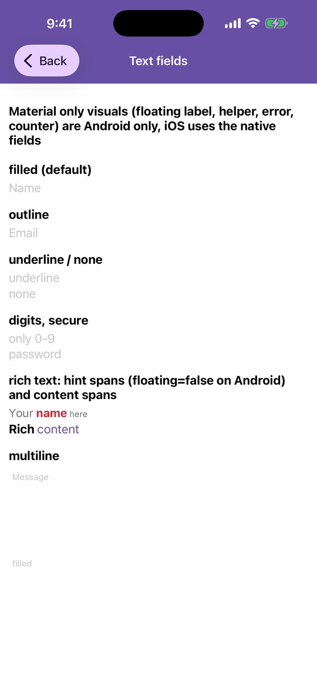
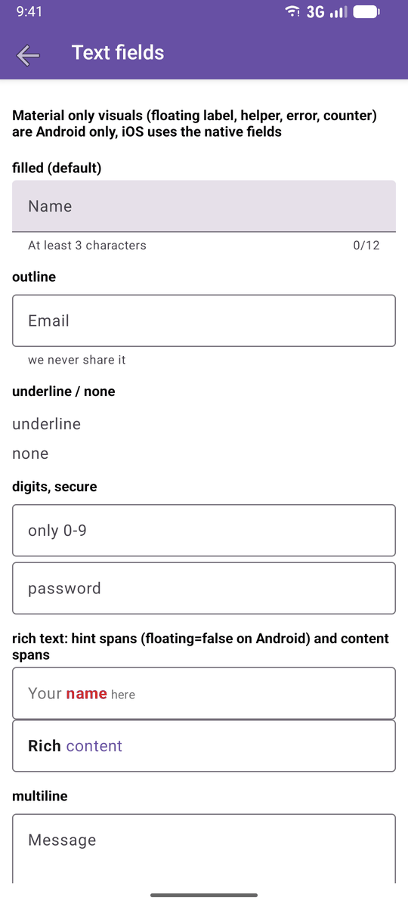

{{ load:../../tools/readme/edit-warning.md }}
{{ template:title }}
{{ template:badges }}
{{ template:description }}

| iOS | Android |
| --- | --- |
|  |  |

{{ template:toc }}

| Android | iOS |
|---|---|
| `TextInputLayout` (Material 3) | `UITextView` |

## Installation

```bash
npm install @nativescript-community/ui-textview
```

The Android components use **Material 3**: see the [repository README](https://github.com/nativescript-community/ui-native-components#installation) for the theme.

## Usage

```xml
<TextView hint="Message" variant="outline" counterMaxLength="100" height="120" />
```

## API

Same properties as `ui-textfield` (variant, helper, error, counter... on Android only).

Also:

- `blur()`: removes the focus and hides the keyboard.
- `isScrollEnabled` (Android): when `false` the text view ignores the touches (no scroll, no selection), for a parent that takes the touch (a sheet dragged from the text).
- `touch` events and gestures work on the text itself on Android.
- Read-only text (`editable="false"`) stays selectable. With the Akylas fork of `@nativescript/core`, `selectable="false"` turns it off.

{{ load:../../tools/readme/demos-and-development.md }}
{{ load:../../tools/readme/questions.md }}
